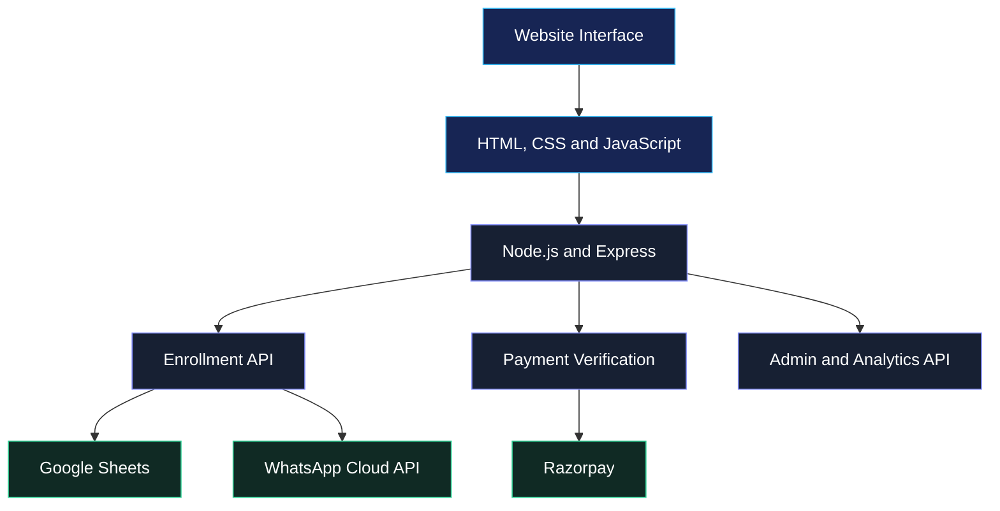

<div align="center">

  

  # XenZ Technologies

  ### AI Learning. Smarter Workflows. Better Opportunities.

  Empowering students and professionals through AI education, intelligent productivity tools, and practical digital skills.

  <p>
    <a href="https://xenztechnologies.in/">
      
    </a>
    <a href="https://github.com/maahii-in/Xenz-Technologies">
      
    </a>
  </p>

  <p>
    <strong>Learn AI</strong> &nbsp; • &nbsp;
    <strong>Discover Tools</strong> &nbsp; • &nbsp;
    <strong>Build Skills</strong>
  </p>

</div>

---

## Overview

**XenZ Technologies** is a web-based AI learning and productivity platform built to help students and professionals explore artificial intelligence, discover useful digital tools, and pursue career-oriented learning opportunities.

The platform combines a modern frontend experience with a Node.js and Express backend to support enrollment, online payments, student information management, and administrative reporting.

Designed with a dark visual theme, responsive layouts, and a streamlined user experience, XenZ Technologies brings its core learning and enrollment features together in one place.

### Project Links

| Resource | Details |
|---|---|
| Live Website | [xenztechnologies.in](https://xenztechnologies.in/) |
| Source Code | [GitHub Repository](https://github.com/maahii-in/Xenz-Technologies) |
| Main Website | `index.html` |
| AI Tools | `ai-tools.html` |
| Enrollment | `enroll.html` |
| Administration | `admin.html` |

---

## Key Features

### AI Learning & Productivity

- AI learning and training information.
- Dedicated AI tools and productivity resources.
- Career-oriented digital learning experience.
- Clean, responsive website interface.
- Animated backgrounds and modern UI components.

### Enrollment & Payments

- Student enrollment form.
- Razorpay payment order creation.
- Server-side payment signature verification.
- Payment confirmation and success pages.
- Configurable training or meeting link after successful payment verification.

### Student Management

- Enrollment record collection.
- Optional Google Sheets integration.
- Student information retrieval.
- Enrollment and revenue analytics.
- Recent enrollment summaries.
- CSV export functionality.

### Notifications & Administration

- Optional WhatsApp Cloud API enrollment notifications.
- Password-protected administrative API endpoints.
- Enrollment overview and reporting.
- Configurable application settings through environment variables.

---

## Technology Stack

| Technology | Purpose |
|---|---|
| HTML5 | Frontend structure |
| CSS3 | Styling, responsive layouts, and animations |
| JavaScript | Frontend interactions and API communication |
| Node.js | Backend runtime |
| Express.js | HTTP server and API endpoints |
| Razorpay | Online payment processing |
| Google Sheets API | Enrollment record management |
| WhatsApp Cloud API | Enrollment notifications |
| dotenv | Environment configuration |
| CORS | Cross-origin request handling |
| Nodemon | Development workflow |

---

## Project Architecture

The application uses a client-server architecture that connects the website interface to backend APIs and optional third-party services.



*Google Sheets and WhatsApp functionality depend on their respective configuration. Payment operations require valid Razorpay credentials.*

---

## Repository Structure

```text
Xenz-Technologies/
│
├── frontend/                 # Frontend resources
├── yaml/                     # YAML-related configuration
│
├── index.html                # Main landing page
├── ai-tools.html             # AI tools page
├── enroll.html               # Enrollment and payment interface
├── admin.html                # Administrative dashboard
├── certificate.html          # Certificate page
├── content.html              # Supporting content page
├── exclude.html              # Supporting page
├── payment-confirm.html      # Payment confirmation page
├── receipt.html               # Receipt page
├── success.html               # Enrollment success page
│
├── server.js                  # Express backend and API routes
├── server.txt                 # Supporting server file
├── students.json              # Student-related JSON data
│
├── logo.png                   # Brand logo
├── xzt.png                    # Brand image asset
├── phone.png                  # Image asset
├── simple cetifi.png          # Certificate image
├── simplecetifi.png           # Certificate image
│
├── package.json               # Dependencies and npm scripts
├── package-lock.json          # Dependency lock file
├── .env.example               # Environment variable template
├── .gitignore                 # Git ignore configuration
├── _config.yml                # Site configuration
└── CNAME                      # Custom domain configuration
```

---

## Getting Started

Follow the instructions below to run the application locally.

### Prerequisites

Ensure that the following tools are installed:

- [Node.js](https://nodejs.org/) version 18 or later.
- npm, included with Node.js.
- [Git](https://git-scm.com/).

Credentials for third-party services are required only when using their corresponding integrations.

### 1. Clone the Repository

```bash
git clone https://github.com/maahii-in/Xenz-Technologies.git
```

Navigate to the project directory:

```bash
cd Xenz-Technologies
```

### 2. Install Dependencies

```bash
npm install
```

### 3. Configure Environment Variables

Create a local `.env` file from the provided template.

**Windows Command Prompt**

```cmd
copy .env.example .env
```

**macOS / Linux**

```bash
cp .env.example .env
```

Open `.env` and provide the appropriate configuration values.

Refer to the [Configuration](#configuration) section for details.

### 4. Start the Server

Start the application:

```bash
npm start
```

Start the development server with automatic restarts:

```bash
npm run dev
```

### 5. Access the Application

Open the following URL in your browser:

**Website:** http://localhost:5000

**Backend Health Check:** http://localhost:5000/api/health

The Express server serves the website files and handles the backend API requests.

---

## Configuration

Application settings are managed through environment variables.

| Variable | Description |
|---|---|
| `PORT` | Backend server port. Defaults to `5000`. |
| `ADMIN_PASSWORD` | Password used by the current administrator authentication implementation. |
| `MEET_LINK` | Training or meeting URL returned after successful payment verification. |
| `RAZORPAY_KEY_ID` | Razorpay public API key. |
| `RAZORPAY_KEY_SECRET` | Razorpay secret used for payment signature verification. |
| `ENROLLMENT_PRICE` | Enrollment price in paise. For example, `3700` represents ₹37. |
| `GOOGLE_SERVICE_ACCOUNT_EMAIL` | Google Cloud service account email. |
| `GOOGLE_PRIVATE_KEY` | Google service account private key. |
| `GOOGLE_SHEET_ID` | Google spreadsheet identifier. |
| `WHATSAPP_PHONE_NUMBER_ID` | WhatsApp Business Cloud API phone-number ID. |
| `WHATSAPP_ACCESS_TOKEN` | WhatsApp Cloud API access token. |
| `WHATSAPP_TEMPLATE_NAME` | Optional enrollment notification template name. |

The WhatsApp variables are optional configuration values supported by the backend. Add them to `.env` when enabling that integration.

### Razorpay Setup

1. Create or access your account at [Razorpay](https://dashboard.razorpay.com/).
2. Obtain your API key ID and secret.
3. Add the credentials to your environment.
4. Test the payment flow using test credentials.
5. Verify successful and unsuccessful payment scenarios before deploying.

**Important:** Never expose the Razorpay secret in frontend code or commit it to GitHub.

### Google Sheets Setup

To enable spreadsheet-based enrollment storage:

1. Create a Google Cloud project.
2. Enable the Google Sheets API.
3. Create a service account.
4. Configure the service account email and private key.
5. Share the target spreadsheet with the service account.
6. Configure `GOOGLE_SHEET_ID`.
7. Ensure that the worksheet is named `Sheet1` and has the expected columns.

The current backend reads and writes enrollment data in the range `Sheet1!A:G`.

### WhatsApp Setup

To enable WhatsApp enrollment confirmations:

1. Configure the WhatsApp Business Cloud API.
2. Obtain the phone-number ID and access token.
3. Configure an approved message template.
4. Set the corresponding environment variables.
5. Test message delivery using an authorized recipient.

Notification delivery depends on valid credentials, template configuration, and the WhatsApp API response.

---

## API Reference

The API routes are implemented in `server.js`.

| Method | Endpoint | Purpose |
|---|---|---|
| `GET` | `/api/health` | Reports backend and integration configuration status. |
| `GET` | `/api/razorpay-key` | Returns the configured Razorpay public key. |
| `POST` | `/api/create-order` | Creates a Razorpay payment order. |
| `POST` | `/api/verify-payment` | Verifies the payment signature and processes enrollment. |
| `POST` | `/api/admin/login` | Validates administrator credentials. |
| `GET` | `/api/students` | Retrieves enrollment records. |
| `GET` | `/api/analytics` | Returns enrollment and revenue statistics. |
| `GET` | `/api/export` | Exports enrollment records as CSV. |

The student, analytics, and export endpoints use the administrator password check implemented in the backend.

### Health Check

Request:

```http
GET /api/health
```

Example response:

```json
{
  "status": "ok",
  "sheetsConnected": false,
  "razorpayConfigured": true,
  "whatsappConfigured": false
}
```

*The values above are illustrative. Actual values depend on the current server configuration.*

### Payment Order Creation

Request:

```http
POST /api/create-order
Content-Type: application/json
```

Example request body:

```json
{
  "name": "Example Student",
  "mobile": "9876543210",
  "email": "student@example.com"
}
```

The backend validates the required fields and creates an order through Razorpay when payment configuration is available.

### Payment Verification

The verification endpoint checks the Razorpay payment signature before processing enrollment information.

```http
POST /api/verify-payment
Content-Type: application/json
```

The request includes the Razorpay order ID, payment ID, payment signature, and enrollment information.

A successful response includes a confirmation message and the configured training link.

---

## Enrollment Workflow

The enrollment and payment process follows this sequence:

1. The student completes the enrollment form.
2. The frontend requests a payment order.
3. The backend creates the order through Razorpay.
4. The student completes checkout.
5. Payment details are submitted to the verification endpoint.
6. The backend verifies the payment signature.
7. Enrollment information is stored through the configured storage integration.
8. An optional WhatsApp confirmation is attempted.
9. The training link is returned after successful verification.

Payment confirmation must be based on server-side verification, not solely on the result displayed by the frontend.

---

## Data Management

The current implementation supports Google Sheets as the enrollment record store.

Enrollment records include:

- Student name.
- Mobile number.
- Email address.
- Enrollment amount.
- Razorpay payment ID.
- Razorpay order ID.
- Enrollment timestamp.

### Storage Considerations

When Google Sheets is configured, the application reads and appends records using the Sheets API.

If Google Sheets is unavailable or not configured, the current implementation falls back to an in-memory array. This fallback is temporary and does not provide persistence across server restarts.

For reliable production operations, use a properly configured persistent storage solution and establish a suitable backup and recovery process.

---

## Deployment

The application can be deployed to a Node.js hosting service.

### Backend Deployment

1. Connect the GitHub repository to your hosting provider.
2. Configure dependency installation:

   ```bash
   npm install
   ```

3. Set the application start command:

   ```bash
   npm start
   ```

4. Add environment variables in the hosting dashboard.
5. Deploy the application.
6. Test the health endpoint.
7. Validate enrollment, payment verification, and administrator functionality.

### Frontend Deployment

The current Express server can serve the frontend directly.

If the frontend and backend are hosted separately:

- Update the API base URL in the frontend.
- Configure CORS for the intended frontend origin.
- Enable HTTPS.
- Verify third-party integration settings.
- Test the entire enrollment workflow in the deployed environment.

---

## Security Considerations

Security is important when handling enrollment information and payment operations.

Recommended practices include:

- Keep environment files and private credentials out of version control.
- Never expose payment secrets in browser-side JavaScript.
- Use HTTPS for production traffic.
- Validate user input on the backend.
- Restrict cross-origin access to the intended domains.
- Use persistent storage for important records.
- Avoid transmitting administrator passwords through URL query parameters.
- Replace basic administrator password checks with robust session-based or token-based authentication before production use.
- Add appropriate rate limiting and request validation.
- Avoid exposing personal information in logs or API errors.
- Test payment verification using Razorpay test mode before processing live transactions.

---

## Development Commands

| Command | Description |
|---|---|
| `npm install` | Installs project dependencies. |
| `npm start` | Starts the Express server. |
| `npm run dev` | Starts the development server with Nodemon. |

---

## Contributing

Contributions and improvements are welcome.

### Contribution Process

1. Fork the repository.
2. Create a feature branch.

   ```bash
   git checkout -b feature/your-feature
   ```

3. Implement your changes and test them.
4. Commit your changes.

   ```bash
   git add .
   git commit -m "Describe your changes"
   ```

5. Push your branch.

   ```bash
   git push origin feature/your-feature
   ```

6. Open a pull request with a clear description of the proposed changes.

For significant changes, open an issue first to discuss the intended implementation.

---

## License

A license file is not currently included in the repository.

Add an appropriate `LICENSE` file to define the terms governing the use, modification, and distribution of the project.

Until licensing terms are established, do not assume that unrestricted reuse is permitted.

---

## Connect With XenZ Technologies

**Website:** [https://xenztechnologies.in/](https://xenztechnologies.in/)

**GitHub:** [https://github.com/maahii-in/Xenz-Technologies](https://github.com/maahii-in/Xenz-Technologies)

---

<div align="center">

  **XenZ Technologies**

  *AI Learning · Productivity · Digital Skills*

  Built to make AI learning and digital productivity more accessible.

</div>
