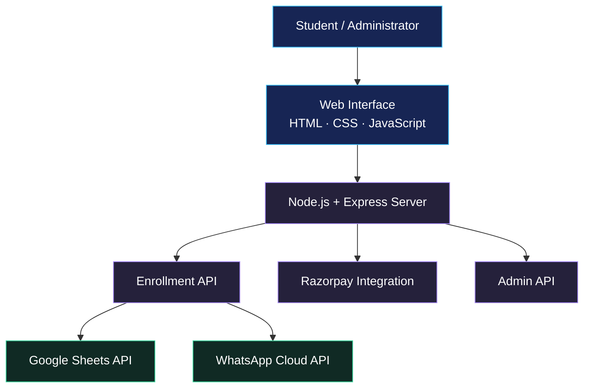

<div align="center">

  

  # XenZ Technologies

  **AI Education · Intelligent Tools · Digital Skills**

  A web-based platform for AI learning, productivity tools, and career-focused digital education.

  <br />

  [](https://xenztechnologies.in/)
  [](https://nodejs.org/)
  [](https://expressjs.com/)
  [](https://developer.mozilla.org/en-US/docs/Web/JavaScript)

  <br />

  [Live Application](https://xenztechnologies.in/) ·
  [Source Code](https://github.com/maahii-in/Xenz-Technologies)

</div>

---

## 01. Project Overview

**XenZ Technologies** is a web platform designed to introduce students and professionals to artificial intelligence, productivity tools, and practical digital learning opportunities.

The application combines a responsive website with a Node.js and Express backend to support student enrollment, online payments, enrollment records, and administrative reporting.

Its interface features a dark visual theme, modern typography, cyan highlights, interactive components, and dedicated pages for learning, enrollment, payment confirmation, and administration.

### Project Objectives

- Provide an accessible entry point for AI learning and productivity resources.
- Simplify the student enrollment and payment experience.
- Integrate payment processing with enrollment record management.
- Provide administrative visibility into enrollment activity and revenue.
- Establish a foundation for expanding digital learning services.

## 02. Core Features

| Module | Capabilities |
|---|---|
| Homepage | Brand presentation, learning information, feature highlights, and enrollment navigation |
| AI Tools | Dedicated interface for discovering AI and productivity resources |
| Enrollment | Student information collection and enrollment workflow |
| Payments | Razorpay order creation and server-side payment signature verification |
| Student Records | Google Sheets integration with an in-memory fallback |
| Administration | Student records, revenue summaries, enrollment analytics, and CSV export |
| Notifications | Optional WhatsApp Cloud API enrollment confirmations |
| Certificates | Dedicated certificate page |
| Confirmation | Payment confirmation, receipt, and enrollment success pages |
| Configuration | Environment-based configuration for backend services |

## 03. Technology Stack

### Frontend

- **HTML5** — semantic page structure.
- **CSS3** — responsive layouts, visual styling, and animations.
- **JavaScript** — browser interactions and backend API communication.

### Backend

- **Node.js** — server-side JavaScript runtime.
- **Express.js** — web server, static file delivery, and REST API routes.
- **Razorpay SDK** — payment order creation.
- **Node.js Crypto** — payment signature verification.
- **Google APIs** — Google Sheets integration.
- **dotenv** — environment variable management.
- **CORS** — cross-origin request configuration.

### External Services

| Service | Role |
|---|---|
| Razorpay | Payment processing |
| Google Sheets | Enrollment data storage |
| WhatsApp Cloud API | Enrollment confirmation messages |
| Google Fonts | Website typography |

## 04. System Architecture

The application uses a client-server architecture. The frontend communicates with Express API endpoints, while the backend integrates with external services when the corresponding credentials are configured.



*The diagram represents the intended application flow. External integrations depend on valid configuration, service availability, and successful requests.*

## 05. Repository Structure

```text
Xenz-Technologies/
│
├── frontend/                # Frontend resources
├── yaml/                    # YAML configuration resources
│
├── index.html               # Homepage
├── ai-tools.html            # AI tools page
├── enroll.html              # Enrollment interface
├── admin.html               # Administrative dashboard
├── certificate.html         # Certificate page
├── content.html             # Supporting content page
├── exclude.html             # Supporting page
├── payment-confirm.html     # Payment confirmation
├── receipt.html             # Receipt page
├── success.html             # Enrollment success page
│
├── server.js                # Node.js / Express backend
├── server.txt               # Supporting server file
├── students.json            # Student-related JSON asset
│
├── logo.png                 # Brand logo
├── phone.png                # Image asset
├── simple cetifi.png        # Certificate image
├── simplecetifi.png         # Certificate image
├── xzt.png                  # Brand image
│
├── package.json             # Dependencies and npm scripts
├── package-lock.json        # Locked dependency versions
├── .env.example             # Environment configuration template
├── .gitignore               # Git ignore configuration
├── _config.yml              # Site configuration
└── CNAME                    # Custom domain configuration
```

## 06. Installation and Local Development

### Prerequisites

Ensure that the following are installed:

- [Node.js](https://nodejs.org/) 18 or later.
- npm.
- [Git](https://git-scm.com/).

Third-party credentials are needed only for the integrations you intend to use.

### Step 1 — Clone the Repository

```bash
git clone https://github.com/maahii-in/Xenz-Technologies.git
cd Xenz-Technologies
```

### Step 2 — Install Dependencies

```bash
npm install
```

### Step 3 — Create the Environment File

**Windows Command Prompt**

```cmd
copy .env.example .env
```

**macOS / Linux**

```bash
cp .env.example .env
```

Open `.env` and configure the required settings.

### Step 4 — Start the Application

Start the production-style server process:

```bash
npm start
```

For development with automatic restarts:

```bash
npm run dev
```

### Step 5 — Open the Application

| Resource | Local URL |
|---|---|
| Website | `http://localhost:5000` |
| API health check | `http://localhost:5000/api/health` |

The Express server serves the root-level website files and handles the backend API requests.

## 07. Environment Configuration

The application loads configuration from environment variables using `dotenv`.

| Variable | Purpose |
|---|---|
| `PORT` | Server port; defaults to `5000` |
| `ADMIN_PASSWORD` | Administrator password used by the current backend |
| `MEET_LINK` | Training link returned following successful payment verification |
| `RAZORPAY_KEY_ID` | Razorpay public key |
| `RAZORPAY_KEY_SECRET` | Razorpay private key secret |
| `ENROLLMENT_PRICE` | Enrollment amount in paise |
| `GOOGLE_SERVICE_ACCOUNT_EMAIL` | Google service account email |
| `GOOGLE_PRIVATE_KEY` | Google service account private key |
| `GOOGLE_SHEET_ID` | Target spreadsheet identifier |
| `WHATSAPP_PHONE_NUMBER_ID` | WhatsApp Cloud API phone-number identifier |
| `WHATSAPP_ACCESS_TOKEN` | WhatsApp API access token |
| `WHATSAPP_TEMPLATE_NAME` | Optional message template name |

### Example Configuration

Use your own credentials; never commit real secrets.

```dotenv
PORT=5000

ADMIN_PASSWORD=replace_with_a_strong_password

MEET_LINK=https://example.com/meeting

RAZORPAY_KEY_ID=your_razorpay_key_id
RAZORPAY_KEY_SECRET=your_razorpay_key_secret

ENROLLMENT_PRICE=3700

GOOGLE_SERVICE_ACCOUNT_EMAIL=your-service-account@example.iam.gserviceaccount.com
GOOGLE_PRIVATE_KEY="your_private_key_with_escaped_newlines"
GOOGLE_SHEET_ID=your_google_sheet_id

WHATSAPP_PHONE_NUMBER_ID=your_phone_number_id
WHATSAPP_ACCESS_TOKEN=your_access_token
WHATSAPP_TEMPLATE_NAME=enrollment_confirmation
```

**Configuration notes:**

- `ENROLLMENT_PRICE` is expressed in paise. For example, `3700` represents ₹37.
- Use the test environment and test keys when developing with Razorpay.
- Configure the Google Sheets integration with a service account and the appropriate spreadsheet permissions.
- WhatsApp configuration is optional.
- The backend uses a worksheet named `Sheet1` and the range `A:G` for enrollment data.
- The actual configuration requirements depend on which services you enable.

## 08. API Reference

The following routes are implemented in `server.js`.

| Method | Endpoint | Description |
|---|---|---|
| `GET` | `/api/health` | Reports service configuration status |
| `GET` | `/api/razorpay-key` | Returns the configured public payment key |
| `POST` | `/api/create-order` | Creates a Razorpay order |
| `POST` | `/api/verify-payment` | Verifies a payment signature and processes enrollment |
| `POST` | `/api/admin/login` | Validates administrator credentials |
| `GET` | `/api/students` | Retrieves student enrollment records |
| `GET` | `/api/analytics` | Returns enrollment and revenue summaries |
| `GET` | `/api/export` | Exports enrollment records as CSV |

### Health Check

**Request**

```http
GET /api/health
```

**Example response**

```json
{
  "status": "ok",
  "sheetsConnected": false,
  "razorpayConfigured": true,
  "whatsappConfigured": false
}
```

The values are illustrative; actual values depend on the server configuration.

### Create Payment Order

**Request**

```http
POST /api/create-order
Content-Type: application/json
```

**Example body**

```json
{
  "name": "Example Student",
  "mobile": "9876543210",
  "email": "student@example.com"
}
```

The server validates the required fields and creates a Razorpay order when payment credentials are configured.

### Verify Payment

**Request**

```http
POST /api/verify-payment
Content-Type: application/json
```

The verification request includes the Razorpay order ID, payment ID, signature, and enrollment information.

The backend verifies the signature before proceeding with enrollment processing and returning the configured meeting link.

### Administrator Endpoints

The student, analytics, and export endpoints use the current administrator password middleware.

The existing implementation accepts an `x-admin-password` header or a password query parameter. For production, prefer secure authentication and remove password transmission through URLs.

## 09. Enrollment and Payment Lifecycle

The enrollment workflow follows these stages:

1. **Enrollment:** The student submits the required information.
2. **Order Creation:** The backend creates a Razorpay payment order.
3. **Checkout:** The student completes the payment process.
4. **Verification:** The backend validates the payment signature.
5. **Record Processing:** The enrollment record is passed to the configured storage mechanism.
6. **Notification:** A WhatsApp confirmation is attempted if the integration is enabled.
7. **Confirmation:** The server returns the enrollment result and configured training link after successful verification.

Payment status must be established by the backend rather than trusted solely from frontend events.

## 10. Data Management

The application supports Google Sheets for enrollment records.

The current record structure includes:

| Field | Description |
|---|---|
| Name | Student name |
| Mobile | Student mobile number |
| Email | Student email address |
| Amount | Enrollment amount |
| Payment ID | Razorpay payment identifier |
| Order ID | Razorpay order identifier |
| Enrolled At | Enrollment timestamp |

### Storage Behavior

When Google Sheets is initialized, the backend reads and appends enrollment records using the Sheets API.

When Sheets is not configured or a storage operation fails, the implementation falls back to an in-memory array.

**Important:** In-memory data is temporary and is lost when the server process restarts. It should not be treated as durable production storage.

For production use, configure a reliable persistent storage solution and establish appropriate backup and recovery procedures.

## 11. Administrative Dashboard

The admin interface provides a central view of enrollment activity.

Its supporting backend functionality includes:

- Administrator password validation.
- Enrollment record retrieval.
- Enrollment totals.
- Revenue summaries.
- Seven-day enrollment statistics.
- Recent enrollment information.
- CSV export.

Before deployment, review the authentication mechanism and introduce suitable access controls for sensitive student information.

## 12. Deployment

The application can be deployed to a Node.js hosting platform, such as [Render](https://render.com/).

### Backend Deployment

1. Connect the repository to your hosting provider.
2. Install dependencies using `npm install`.
3. Set the start command to `npm start`.
4. Configure the environment variables in the hosting dashboard.
5. Deploy the application.
6. Test the `/api/health` endpoint.
7. Validate enrollment, payment verification, and administrator access.

### Frontend Configuration

The current server serves the frontend from the project root.

If the frontend and backend are hosted on separate domains:

- Update the API base URL used by the frontend pages.
- Configure the backend CORS allow-list.
- Use HTTPS for production traffic.
- Verify all third-party service credentials.
- Test the entire enrollment workflow.

## 13. Security Guidelines

Security is essential because the application handles personal information and payment-related operations.

Before production deployment:

- Keep `.env` and all private credentials out of version control.
- Use a strong, unique administrator password.
- Never expose payment secrets in frontend JavaScript.
- Validate and sanitize user input on the server.
- Restrict CORS to trusted origins.
- Use HTTPS for all production endpoints.
- Avoid transmitting administrator passwords in URL query parameters.
- Replace basic password checks with robust session-based or token-based authentication.
- Add rate limiting and appropriate request validation.
- Use persistent storage for important enrollment records.
- Avoid logging private keys, credentials, or unnecessary personal information.
- Test payment processing with Razorpay test credentials before enabling live transactions.

## 14. Development Commands

| Command | Description |
|---|---|
| `npm install` | Installs project dependencies |
| `npm start` | Starts the Express server |
| `npm run dev` | Starts the server using Nodemon |

## 15. Contributing

Contributions, bug reports, and improvements are welcome.

### Workflow

1. Fork the repository.
2. Create a feature branch.

   ```bash
   git checkout -b feature/your-feature
   ```

3. Implement and test your changes.
4. Commit your changes.

   ```bash
   git add .
   git commit -m "Describe your changes"
   ```

5. Push your branch.

   ```bash
   git push origin feature/your-feature
   ```

6. Open a pull request with a clear explanation of the changes.

Please keep contributions focused, readable, and consistent with the existing project structure.

## 16. License

No license file is currently present in the repository.

Add an appropriate `LICENSE` file to establish the permissions and conditions for using, modifying, and distributing the project.

Until a license is provided, do not assume that unrestricted reuse is permitted.

---

<div align="center">

  <strong>XenZ Technologies</strong>

  <p>AI Learning · Productivity · Digital Skills</p>

  <a href="https://xenztechnologies.in/">Website</a>
  &nbsp; · &nbsp;
  <a href="https://github.com/maahii-in/Xenz-Technologies">GitHub Repository</a>

</div>
